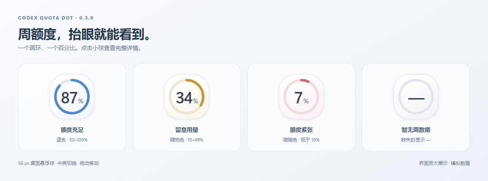

# Codex Quota Dot

**Your Codex quota, at a glance.**

Codex Quota Dot is a small floating desktop widget for **Codex CLI and Codex Desktop on Windows and macOS**. It shows the quota windows your account actually reports, including remaining usage and reset times, without opening a usage page or signing in again.

[简体中文](README.zh-CN.md) · [Download](https://github.com/Silvren/codex-quota-dot/releases/latest) · [Report a bug](https://github.com/Silvren/codex-quota-dot/issues/new/choose)

[](https://github.com/Silvren/codex-quota-dot/releases/latest)
[](https://github.com/Silvren/codex-quota-dot/actions/workflows/ci.yml)
[](LICENSE)

> This is an independent open-source project and is not affiliated with or endorsed by OpenAI.

中文简介：Codex 配额桌面悬浮球，一眼查看账户实际返回的剩余额度与重置时间；支持短周期和每周额度。

## Do you still need it?

If Codex's built-in usage display covers your workflow, you can skip this app. The CLI also offers an in-terminal usage display through [`/statusline`](https://learn.chatgpt.com/docs/developer-commands?surface=cli). Quota Dot is for people who want a small, movable, always-on-top indicator while working in a terminal, editor, or another window. CLI-only setups are supported too.

This remains a small, maintained utility. Updates focus on Codex compatibility, process stability, and useful bug fixes, with no fixed feature-release schedule. The [official usage dashboard and CLI `/status`](https://learn.chatgpt.com/docs/pricing#where-can-i-see-my-current-usage-limits) remain the reference for account limits.

## Interface preview



The orb always shows the reported weekly quota as a single ring, with blue at `50–100%`, amber at `10–<50%`, and coral below `10%`. It does not fall back to a short-period quota when weekly data is unavailable; the ring shows `—`. The expanded card retains the available short-period and weekly quota details.

## Download

Download the latest build from [GitHub Releases](https://github.com/Silvren/codex-quota-dot/releases/latest):

- Windows x64
- macOS Apple Silicon
- macOS Intel

> **Release signing:** current packages are not code-signed. Windows SmartScreen or antivirus software may therefore show a reputation or heuristic warning. Download only from this repository's GitHub Releases page, verify the accompanying `.sha256` file, and do not disable security software or add an exclusion just to run the app. See [Windows download safety](docs/windows-download-safety.md) for verification steps and reporting guidance.

## Current status

`v0.3.0` adds a weekly quota ring to the 56 px orb. It includes v0.2.5's graceful app-server shutdown fix, development dependency updates, and platform build checks. Thanks to @derekhe for [#7](https://github.com/Silvren/codex-quota-dot/pull/7). Follow-up on the Windows LSASS/RPC crash remains in [#6](https://github.com/Silvren/codex-quota-dot/issues/6).

The widget reads the quota periods Codex returns; the orb uses the weekly window, while the card retains available short-period and weekly details. It also shows credit balances, reset-credit details, and explicit cached/error states. See [maintenance scope](docs/maintenance.md).

### Credit balance

`v0.2.4` displays the balance returned by Codex in the expanded card, using the existing refresh flow and window size. Values are **credits, not USD**: the Settings currency amount requires additional pricing metadata and is not converted here. Missing balances display `—`, not zero. See the v0.2.4 release assets for downloads.

### Start in three steps

1. Install Codex Desktop or Codex CLI and sign in there. This widget does not ask for your credentials.
2. Download the package for your OS from [Releases](https://github.com/Silvren/codex-quota-dot/releases/latest). Windows users can choose the installer or extract the portable ZIP; macOS users should choose Apple Silicon or Intel.
3. Launch Codex Quota Dot. **Drag to move, click to expand, Esc to collapse.** Hover does not open the card.

For CLI-only setups, `codex` must be available on PATH, or set `CODEX_BINARY` to its executable before starting the widget. If both Desktop and CLI are installed, the widget prefers the Desktop binary unless `CODEX_BINARY` is set. Quota availability depends on the account and the installed Codex version.

### What it shows

- ChatGPT plan reported by Codex
- the currently available short-period and weekly quota windows
- reset times and overall health
- individual reset-credit expiration dates, shown in local time and sorted earliest first
- best-effort `consuming` / `idle` inference from successive quota changes
- last-update and honest cached/unknown states

The compact **56 px quota orb** stays on top and shows the weekly quota as a single ring. Drag to reposition and snap to a screen edge; click to open the **320 × 256 quota card**. Hover never opens or closes the card. Use the explicit collapse control or press `Esc` to return to the orb. The card retains available short-period and weekly quota details, plus Chinese/English switching and a clearly indicated always-on-top toggle. Sizes are logical pixels and follow OS display scaling.

The runtime has just three frontend dependencies (React, React DOM and the Tauri API); the three control icons are inline SVG. There is no bundled browser, sync service, mobile client, telemetry, or extra server in this desktop release.

## Quota-window availability

Codex Quota Dot is not restricted to Plus: it reads the actual quota windows returned for the signed-in account, including Pro. Their presence and duration can vary by plan, workspace, promotion, and rollout.

- The orb shows the reported weekly window for every plan. The card retains available short-period and weekly quota details; labels follow the reported duration rather than assuming five hours.
- If weekly data is missing, the orb shows `—` instead of falling back to a short-period value. Missing windows are not interpreted as unlimited usage or 100% remaining.
- Other reported durations are supported too. A window without a duration is labeled simply “Quota remaining”.
- With no usable percentage, the app stays neutral and shows unavailable data. Missing windows are **not** interpreted as unlimited usage, 100% remaining, or a failed login.
- Older cached snapshots remain readable and are clearly marked as saved data.

中文说明：Plus、Pro 等套餐的小球统一显示实际返回的周额度。缺少周额度数据时显示 `—`，不回退到短周期额度；卡片仍保留实际返回的短周期和周额度详情。

This project does not claim that OpenAI has permanently or universally removed a specific quota window. See [official pricing and usage guidance](https://learn.chatgpt.com/docs/pricing).

## Privacy design

The native backend starts the installed `codex app-server` and calls its documented `account/read` and `account/rateLimits/read` JSON-RPC methods. Codex itself owns authentication. This app:

- never reads or copies `auth.json`, tokens, cookies, conversations, session rollouts, or project files;
- never passes credentials to the WebView;
- stores only settings, position, and the normalized usage snapshot in WebView local storage;
- has no telemetry, analytics, ads, crash upload, or project server;
- discards Codex subprocess logs and never logs raw account responses.

Codex may contact OpenAI to obtain the usage snapshot, as it normally does. See [`docs/privacy.md`](docs/privacy.md) and [`docs/data-source-research.md`](docs/data-source-research.md).

## Development

Prerequisites:

- Node.js 22+
- Rust stable
- the [Tauri 2 platform prerequisites](https://v2.tauri.app/start/prerequisites/)
- Codex Desktop or Codex CLI available as `codex` (or set `CODEX_BINARY` to its executable)

```powershell
npm install
npm test
npm run typecheck
npm run tauri dev
```

Browser-only preview:

```powershell
npm run dev
```

The browser preview intentionally uses labeled mock data. Native builds never silently fall back to mock values.

Production build:

```powershell
npm run tauri build
```

## Known limitations

- Rust/native build verification is required on every target OS; WebView behavior differs across Windows and macOS.
- Each refresh starts a short-lived app-server subprocess and closes it gracefully, with a five-second fallback deadline. A persistent connection needs separate lifecycle validation.
- Passing macOS builds do not cover every native interaction, multi-monitor layout, or DPI setting.
- Start-at-login and a full settings screen are intentionally not included; the widget keeps controls limited to language, always-on-top, reset-credit details, and refresh.
- `consuming` is inferred from a decrease between snapshots. It does not mean a Codex task is definitely running.
- The provider depends on the installed Codex version exposing the documented app-server account methods. Structural changes fail closed as `Unknown`.

## Documentation

- [`docs/architecture.md`](docs/architecture.md)
- [`docs/data-source-research.md`](docs/data-source-research.md)
- [`docs/privacy.md`](docs/privacy.md)
- [`docs/security-model.md`](docs/security-model.md)
- [`docs/windows-download-safety.md`](docs/windows-download-safety.md)
- [`docs/releasing.md`](docs/releasing.md)
- [`CONTRIBUTING.md`](CONTRIBUTING.md)
- [`SECURITY.md`](SECURITY.md)
- [`THIRD_PARTY_NOTICES.md`](THIRD_PARTY_NOTICES.md)

## License

[MIT](LICENSE). It is short, permissive, and appropriate for a small cross-platform utility.
